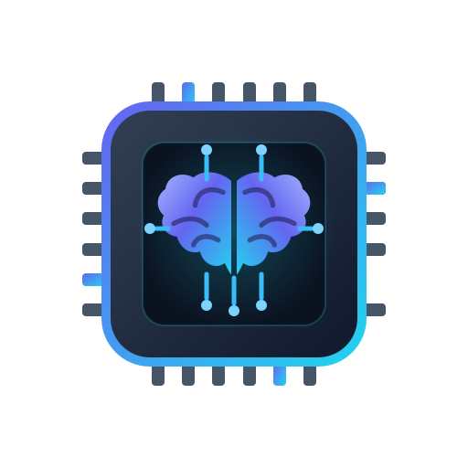

<div align="center">
  <a href="https://github.com/wprudencio/awesome-ai-cpu">
    
  </a>
</div>

# 🧠 Awesome AI Projects for CPU

 [](LICENSE) [](CONTRIBUTING.md)

> A curated list of **open source AI projects** that run well on **CPU**, no GPU required.  
> Perfect for makers, indie developers, and local AI experiments.

**Last updated:** November 2026 — featuring projects from 2025–2026

-----

## 📑 Table of Contents

- [Language Models](#-language-models-chatbots--text)
- [Inference Engines & Runtimes](#-inference-engines--runtimes)
- [Image Generation and Editing](#️-image-generation-and-editing)
- [Voice and Audio](#-voice-and-audio)
- [Computer Vision & OCR](#️-computer-vision--ocr)
- [Small Models](#-small-models-perfect-for-cpu)
- [AI Assistants & Agents](#-ai-assistants--agents)
- [Coding Assistants](#-coding-assistants)
- [Document & Knowledge (RAG)](#-document--knowledge-rag)
- [Agentic Workflows & Platforms](#-agentic-workflows--platforms)
- [Embeddings & Vector Databases](#-embeddings--vector-databases)
- [Translation](#-translation)
- [Development Tools](#️-development-tools)
- [Tips for CPU](#️-tips-for-running-on-cpu)

-----

## 🧠 Language Models (Chatbots / Text)

- [**Ollama**](https://github.com/ollama/ollama) — "Docker for local LLMs." Run Llama, Gemma, DeepSeek, Qwen, gpt-oss and more with one command. Excellent CPU support, easy CLI, model library.
- [**LM Studio**](https://lmstudio.ai/) — Beautiful GUI app for local LLMs, automatically supports CPU execution. _Note: free to use, but not open source._
- [**Jan.ai**](https://github.com/janhq/jan) — ChatGPT-like interface that runs 100% offline with a clean, modern UI.
- [**GPT4All**](https://github.com/nomic-ai/gpt4all) — Simple interface to run LLMs locally with several CPU-optimized models included.
- [**LocalAI**](https://github.com/mudler/LocalAI) — OpenAI-compatible API for running local models. Drop-in replacement that also supports vision, voice, image gen — no GPU required.
- [**Open WebUI**](https://github.com/open-webui/open-webui) — Self-hosted, offline ChatGPT-style interface for Ollama, with RAG, web search, and multi-user support.
- [**Kobold.cpp**](https://github.com/LostRuins/koboldcpp) — Lightweight inference engine for GGUF models with built-in web UI.
- [**text-generation-webui**](https://github.com/oobabooga/text-generation-webui) — The classic local-LLM desktop app ("oobabooga"). Runs GGUF via llama.cpp on CPU, ships an OpenAI/Anthropic-compatible API server, and supports vision and tool calling.
- [**LibreChat**](https://github.com/danny-avila/LibreChat) — Self-hosted, multi-user ChatGPT-style app. Point it at Ollama, LM Studio, or any OpenAI-compatible local backend; agents, MCP, and RAG included.
- [**LobeChat**](https://github.com/lobehub/lobe-chat) — Self-hosted AI chat framework with plugins, agents, and local-model support via Ollama or any OpenAI-compatible endpoint.
- [**PocketPal AI**](https://github.com/a-ghorbani/pocketpal-ai) — Private AI assistant that runs LLMs entirely on your phone. Uses llama.cpp with CPU as universal fallback — no account, no cloud, no internet required. Available on iOS and Android.

-----

## ⚡ Inference Engines & Runtimes

- [**llama.cpp**](https://github.com/ggml-org/llama.cpp) — The gold standard for CPU-optimized LLM inference in C/C++. Powers Ollama, LM Studio, and most local LLM tools.
- [**llamafile**](https://github.com/mozilla-ai/llamafile) — Mozilla's single-file LLM executable. Distribute and run LLMs as a standalone binary — no installation, no dependencies, no GPU required. Built on llama.cpp, supports CPU inference out of the box.
- [**ik_llama.cpp**](https://github.com/ikawrakow/ik_llama.cpp) — MIT-licensed llama.cpp fork focused on CPU speed and state-of-the-art quantization. Roughly 2x mainline token generation on CPU, with Flash Attention on CPU and the fastest CPU-only path for DeepSeek-family models.
- [**BitNet**](https://github.com/microsoft/BitNet) — Microsoft's official inference framework for 1-bit LLMs. Extremely efficient on CPU.
- [**mistral.rs**](https://github.com/EricLBuehler/mistral.rs) — Fast, flexible LLM inference engine in Rust, built on Candle. Prebuilt CPU binaries and CPU Docker images mean no GPU or CUDA toolkit needed. Smart in-situ quantization (GGUF, GPTQ, AWQ) and hardware-aware tuning optimize for your CPU.
- [**MNN**](https://github.com/alibaba/MNN) — Alibaba's lightweight, high-performance inference engine for mobile and edge AI. Optimized assembly for ARM/x64 with FP16/Int8 quantization, plus LLM and Stable Diffusion runtime support (MNN-LLM). No dependencies, ~800KB core, battle-tested in 30+ Alibaba apps.
- [**ncnn**](https://github.com/Tencent/ncnn) — Tencent's mobile-first inference framework. Hand-tuned ARM NEON / x86 SSE kernels, quantization, and zero third-party dependencies — runs CNNs, ViTs, and LLMs on phones, Raspberry Pis, and old laptops.
- [**LiteRT**](https://github.com/google-ai-edge/LiteRT) — Google's on-device runtime (formerly TensorFlow Lite). The default CPU delegate powers ML on Android and edge devices, with optional NPU/GPU delegates.
- [**ONNX Runtime**](https://onnxruntime.ai/) — Cross-platform ML inference with CPU-optimized execution providers (OpenVINO, XNNPACK, CoreML). The engine behind many tools in this list. _(GitHub repo temporarily unavailable — packages on PyPI/NuGet/npm unaffected.)_
- [**OpenVINO**](https://github.com/openvinotoolkit/openvino) — Intel's optimization toolkit for high-performance CPU inference across vision, language, and audio models.
- [**CTranslate2**](https://github.com/OpenNMT/CTranslate2) — Fast inference engine for Transformer models. Powers Faster Whisper, optimized for CPU with Intel MKL and ONNX.
- [**Magnitude**](https://github.com/magnitudedev/magnitude) — Open-source inference engine that compiles and tunes kernels on your device for up to 2x faster inference than llama.cpp. Works on Apple Silicon, NVIDIA, AMD, or CPU only — Apache 2.0, connects to Pi, OpenCode, Hermes, Codex and more via an OpenAI-compatible API.
- [**Sonar**](https://github.com/dphnAI/sonar) — Large-scale LLM inference engine based on vLLM with CPU, ROCm, Metal, and CUDA support. Continuous batching, paged KV-cache, speculative decoding, multi-node parallelism, and multimodal model serving. OpenAI-compatible API.
- [**exo**](https://github.com/exo-explore/exo) — Connect multiple devices (Macs, Linux machines, phones) into a single AI cluster. Automatically discovers devices, splits models across them, and runs frontier LLMs on CPU (Linux) or Apple Silicon MLX (macOS). OpenAI-compatible API.
- [**Krasis**](https://github.com/brontoguana/krasis) — Hybrid LLM runtime focusing on efficient execution of larger models on consumer hardware (CPU + limited VRAM).
- [**eLLM**](https://github.com/lucienhuangfu/eLLM) — Rust-based inference engine that claims to run LLMs faster on CPU than on GPU through aggressive optimization.
- [**cpubrrr**](https://github.com/arizqi/cpubrrr) — Frontier-class LLM inference on a laptop CPU. From-scratch NEON/SME SIMD kernels in Rust achieve ~110 tok/s on a 20B MoE model (gpt-oss:20b) on Apple M4 Max — 7.5× faster than llama.cpp, no GPU required.
- [**deepseek.cpp**](https://github.com/andrewkchan/deepseek.cpp) — Lean, dedicated CPU-only inference engine for the DeepSeek family (V2, V2.5, V3, R1) in C++. Tiny codebase (~2k LOC), supports Q2_K/Q3_K/F8E5M2 quantizations, and rivals llama.cpp decode speed on CPU.
- [**quant.cpp**](https://github.com/quantumaikr/quant.cpp) — Pure C, zero-dependency LLM inference engine with lossless KV cache compression. Achieves 6.4× compression enabling 128K context on a 16GB Mac — makes chunking unnecessary. Ollama-style CLI, OpenAI-compatible server, Python bindings (`pip install quantcpp`).
- [**BigMoeOnEdge**](https://github.com/Helldez/BigMoeOnEdge) — Run MoE models bigger than your RAM entirely on CPU. Lossless offloading lets you run a 284B MoE model on a 12 GB phone using stock llama.cpp — no GPU, no cloud.
- [**Colibrì**](https://github.com/JustVugg/colibri) — Pure C, zero-dependency engine that runs frontier MoE models (744B up to 2.8T params) on consumer hardware by treating disk, RAM, and VRAM as one inference hierarchy — experts stream from disk on demand. CPU-only works; CUDA/Metal/Vulkan optional.
- [**Janas**](https://github.com/prabanta-dev/janas) — Dependency-free C engine for MoE LLMs that streams expert weights from an NVMe SSD and caches the hottest ones in RAM, so Qwen3-Next-80B (48 GB) runs on a 32 GB laptop CPU at ~26 tok/s with 20 threads. Multithreaded CPU write path with optional Vulkan GPU and Intel NPU offload (GPL-3.0).
- [**kimi-k3-in-c**](https://github.com/FareedKhan-dev/kimi-k3-in-c) — Pure C99 inference engine for Kimi K3 (2.78T params) running on a single CPU in 8.24 GB RAM. Zero dependencies, no BLAS, no GPU — portable C99 with AVX2/SIMD optimization.
- [**reame**](https://github.com/swellweb/reame) — CPU-first LLM inference server built for ternary models. Runs an 8B-param model in 2.2 GB RAM on a free Oracle ARM box, outperforming llama.cpp's own ternary fork. OpenAI-compatible API, two engines (nucleo for ternary + llama.cpp for everything else), MIT licensed.
- [**bebelm**](https://github.com/maximecb/bebelm) — CPU-only, pure-Rust implementation of LiquidAI's LFM2.5-8B-A1B LLM. Zero GPU dependency, designed for fast local inference on consumer hardware.
- [**gpt-oss.java**](https://github.com/amzn/gpt-oss.java) — Pure Java implementation of OpenAI's gpt-oss inference in ~1000 lines, with no PyTorch, C++, or native dependencies. CPU-optimized MoE inference (GQA, RoPE, SwiGLU, MXFP4 SIMD kernels) that runs on commodity hardware with only the Java runtime and model weights.
- [**OlliteRT**](https://github.com/NightMean/OlliteRT) — Ollama for Android: turn your phone into an OpenAI-compatible LLM server. Runs models fully locally on mobile CPU/GPU via Google's LiteRT-LM runtime — private, offline, no cloud needed.
- [**Project Zero**](https://github.com/shifulegend/project-zero) — Pure C, single-binary CPU inference engine for BitNet ternary and dense GGUF models. OpenAI-compatible server, RAG memory, and agentic tool-use loop with no GPU or Python required.
- [**OxiBonsai**](https://github.com/cool-japan/oxibonsai) — Zero-FFI pure-Rust inference engine for PrismML's 1-bit and ternary Bonsai models (Qwen3 architecture up to 8B) with runtime-dispatched AVX2/AVX-512/NEON kernels; the 8B 1-bit model is a 1.15 GB GGUF. Apache-2.0.
- [**Frink**](https://github.com/antonellof/frink) — Pure-Rust GGUF inference engine with no llama.cpp/ggml bindings — loader, quantized kernels, attention, and expert routing all written in Rust. Dense and MoE models on CPU, Apple Metal, or CUDA; CLI plus OpenAI/Anthropic-compatible server with continuous batching and paged KV. Beats llama.cpp's CPU path on small models. Apache-2.0.
- [**MemVanta**](https://github.com/sauravsingla/MemVanta) — Low-memory C++20 LLM inference runtime for quantized GGUF models on CPU: mmap-backed weights, paged KV cache, Q4/Q8 kernels, and reproducible llama.cpp benchmarks.
- [**HyMT2Sharp**](https://github.com/sdcb/HyMT2Sharp) — Pure C# inference engine for Tencent's Hy-MT2 1.8B translation model with hand-written AVX2 / AVX-512 / NEON SIMD kernels and an OpenAI-compatible server; GGUF quantization down to 1.25-bit in ~440 MB. Apache-2.0.
- [**vla.simd**](https://github.com/cair-vinuni/vla.simd) — C++ inference engine for Vision-Language-Action robot policies (ACT, IMPACT, SmolVLA, Octo, TurboVLA, Diffusion Policy) with its own tensors, operators, and AVX2/NEON kernels — no GPU, CUDA, or ggml dependency. INT8 W8A8 runs ACT in ~50-60 ms per action chunk on desktop x86 CPUs (~490 ms on a Raspberry Pi 5). Apache-2.0.
- [**Qwen3.5-asm**](https://github.com/suayptalha/qwen3_5-assembly) — Qwen3.5-0.8B inference engine in hand-written x86-64 assembly — tokenizer, chat template, forward pass, sampling and decoding all in assembly, statically linked with direct syscalls and no libc, Python, GPU, or ML framework at runtime, with AVX2/FMA kernels and roughly 1.5x single-thread decode over CPU PyTorch. Apache-2.0.

-----

## 🖼️ Image Generation and Editing

- [**stable-diffusion.cpp**](https://github.com/leejet/stable-diffusion.cpp) — Pure C/C++ inference engine for Stable Diffusion, FLUX, Wan, Qwen Image, and more. Built on ggml (same as llama.cpp) — runs entirely on CPU with AVX/AVX2/AVX512 support. Supports SD1.x through SD3.5, FLUX, LoRA, ControlNet, video generation, and upscaling. A self-contained alternative to Python-based SD pipelines.
- [**ComfyUI**](https://github.com/comfyanonymous/ComfyUI) — Node-based UI for image AI pipelines, supports CPU workflow.
- [**FastSD CPU**](https://github.com/rupeshs/fastsdcpu) — Fast Stable Diffusion on CPU and AI PC. Supports SDXL, SD 1.5, LCM, and FLUX — optimized for CPU inference.
- [**Fooocus**](https://github.com/lllyasviel/Fooocus) — Simplified Stable Diffusion, easier to use than ComfyUI.
- [**InvokeAI**](https://github.com/invoke-ai/InvokeAI) — Professional creative engine for image and video generation, with solid CPU support.
- [**Real-ESRGAN**](https://github.com/xinntao/Real-ESRGAN) — AI image upscaler, fast on CPU with great results.
- [**GFPGAN**](https://github.com/TencentARC/GFPGAN) — Restores and improves old/blurry faces in photos, runs efficiently on CPU.
- [**CodeFormer**](https://github.com/sczhou/CodeFormer) — Blind face restoration with a codebook lookup transformer — robust on heavily degraded photos, CPU-capable. [NeurIPS 2022]
- [**Upscayl**](https://github.com/upscayl/upscayl) — Cross-platform AI image upscaler with simple GUI. Works great on CPU.
- [**Rembg**](https://github.com/danielgatis/rembg) — Background removal for images and video with U2Net-family models — CLI and Python API, CPU-friendly.
- [**video2x**](https://github.com/k4yt3x/video2x) — Video super-resolution and frame interpolation framework (Real-ESRGAN, Real-CUGAN, RIFE, and more), with CPU-capable backends.
- [**FaceFusion**](https://github.com/facefusion/facefusion) — Next-gen face swap, lip-sync, and enhancement. CPU and GPU, 30+ languages, actively maintained.

-----

## 🎤 Voice and Audio

### 🗣️ Speech-to-Text

- [**whisper.cpp**](https://github.com/ggml-org/whisper.cpp) — Highly optimized Whisper (OpenAI) for CPU speech recognition. The fastest Whisper implementation for CPU. ARM NEON, AVX, and quantization support built in.
- [**Faster Whisper**](https://github.com/SYSTRAN/faster-whisper) — Up to 4x faster than original Whisper using CTranslate2. Excellent CPU performance.
- [**transcribe.cpp**](https://github.com/handy-computer/transcribe.cpp) — Comprehensive C/C++ speech-to-text engine supporting 16 model families (Whisper, Parakeet, Canary, Moonshine, SenseVoice, Qwen3-ASR, Granite Speech, Voxtral, and more) via GGUF models on the ggml runtime. tinyBLAS-accelerated CPU path, no GPU required. 60+ model variants with streaming and batch modes.
- [**parakeet.cpp**](https://github.com/mudler/parakeet.cpp) — C++17 port of NVIDIA's NeMo Parakeet ASR models built on ggml, from the LocalAI team. Runs all Parakeet checkpoints (CTC, RNNT, TDT, multilingual) with byte-identical transcripts, up to 1.86× faster than PyTorch on CPU. GGUF quantization (f16–q4_k), cache-aware streaming with end-of-utterance detection.
- [**Moonshine**](https://github.com/moonshine-ai/moonshine) — Ultra-low-latency speech-to-text toolkit for live voice agents. Tiny (27M) to Medium (245M) models beat Whisper on accuracy at 5x the speed, running on-device via ONNX on Linux, macOS, Windows, Raspberry Pi, iOS, and Android.
- [**FunASR-GGML**](https://github.com/huaxin0/FunASR-GGML) — Pure C++17 speech recognition engine powered by FunASR's SenseVoice architecture. GGML/GGUF format, real-time mic streaming with VAD, single-file models, no Python dependency. Excellent for multilingual and Chinese ASR on CPU.
- [**Vosk**](https://github.com/alphacep/vosk-api) — Offline speech recognition, very lightweight (50MB models).
- [**sherpa-onnx**](https://github.com/k2-fsa/sherpa-onnx) — Comprehensive speech processing toolkit powered by ONNX Runtime. Speech-to-text, TTS, speaker diarization, VAD, keyword spotting — all on CPU. Cross-platform (x86, ARM, RISC-V, Android, iOS, Raspberry Pi).
- [**silero-vad**](https://github.com/snakers4/silero-vad) — The de-facto standard voice activity detection. Tiny, enterprise-grade, and blazing fast on CPU — the gatekeeper that keeps Whisper-style pipelines from hallucinating on silence.
- [**Diarize**](https://github.com/FoxNoseTech/diarize) — Speaker diarization — "who spoke when?" CPU-only, no API keys, 8x faster than real-time.
- [**Maivi**](https://github.com/MaximeRivest/maivi) — Cross-platform desktop app for real-time voice-to-text with hotkey support. Uses NVIDIA Parakeet TDT 0.6B for high accuracy (~6-9% WER) on CPU. Auto-copies transcription to clipboard.

### 🔊 Text-to-Speech & Voice

- [**Piper TTS**](https://github.com/rhasspy/piper) — Fast, local text-to-speech with small voice models (5-20MB). _Note: archived but still the standard for tiny, fast TTS._
- [**Pocket TTS**](https://github.com/kyutai-labs/pocket-tts) — Lightweight, CPU-first TTS from Kyutai Labs. 100M params, runs ~6x faster than real-time on a MacBook Air M4 using only 2 CPU cores. Voice cloning, multi-language, streaming audio with ~200ms latency, and handles infinitely long text. `pip install pocket-tts`.
- [**MOSS-TTS-Nano**](https://github.com/OpenMOSS/MOSS-TTS-Nano) — Ultra-compact (0.1B params) multilingual TTS from OpenMOSS. Runs realtime on a 4-core CPU, supports Chinese + English + more, with ONNX CPU inference and voice cloning. Apache-2.0.
- [**VoxCPM**](https://github.com/OpenBMB/VoxCPM) — Tokenizer-free TTS from OpenBMB that generates speech via diffusion autoregressive architecture. VoxCPM2 (2B params) supports 30 languages, voice design, controllable voice cloning, and 48kHz audio. Runs on CPU via `--device cpu`, with GGML and ONNX CPU builds available.
- [**Kokoro-FastAPI**](https://github.com/remsky/Kokoro-FastAPI) — Dockerized FastAPI wrapper for the Kokoro-82M TTS model with prebuilt CPU images. OpenAI-compatible Speech endpoint, 8 languages, voice mixing, and per-word timestamps. Deploy on any CPU server with a single `docker run`.
- [**ChatTTS**](https://github.com/2noise/ChatTTS) — Generative dialogue TTS with fine-grained control (laughs, pauses, speaker identity). The compact model runs on CPU.
- [**CosyVoice**](https://github.com/FunAudioLLM/CosyVoice) — Multi-lingual large voice generation model from FunAudioLLM. Supports voice cloning.
- [**Chatterbox TTS Server**](https://github.com/devnen/Chatterbox-TTS-Server) — Self-host Resemble AI's Chatterbox TTS (Original, Multilingual, Turbo) behind an OpenAI-compatible API with Web UI. Voice cloning, audiobook generation, 23 languages. Runs on CPU with automatic GPU fallback.
- [**OmniVoice-Studio**](https://github.com/debpalash/OmniVoice-Studio) — The open-source ElevenLabs alternative: voice cloning, TTS, ASR, dubbing, and dictation in a single desktop app. Supports 646 languages, auto-detects CUDA/MPS/ROCm/CPU and auto-offloads to CPU when no GPU is available. Fully local, no API keys.
- [**omnivoice.cpp**](https://github.com/ServeurpersoCom/omnivoice.cpp) — GGML-powered local TTS with voice cloning and voice design across 646 languages. C++17 port of OmniVoice with Q8_0 quantization, 24 kHz output, and a dedicated CPU build script. Embeddable C API for integration.
- [**Kitten-TTS 2 C++**](https://github.com/KittenML/kitten-tts-2-cpp) — Native C++ inference for KittenTTS 2 on GGML, with a CPU LibTorch waveform decoder and ternary weights losslessly packed into a 1.03 GB GGUF; built-in voices, emotion and emphasis tags, 24 kHz WAV output, no Python at runtime. MIT.
- [**Qwen3-TTS**](https://github.com/gabriele-mastrapasqua/qwen3-tts) — Pure C inference engine for Qwen3-TTS. No Python, no PyTorch — just C and BLAS. Supports 0.6B/1.7B models.
- [**VibeVoice**](https://github.com/microsoft/VibeVoice) — Microsoft's open-source frontier voice AI. Unified ASR (speech-to-text) and TTS. The BitNet CPU engine (VibeASR.cpp) compresses the 7B ASR model to 1.58 GB and runs real-time inference on 3+ CPU threads — no GPU required.
- [**RVC (Voice Conversion)**](https://github.com/RVC-Project/Retrieval-based-Voice-Conversion-WebUI) — Real-time voice conversion, CPU compatible.
- [**Pipecat**](https://github.com/pipecat-ai/pipecat) — Open-source framework for building voice agents: transports, turn-taking, and multimodal pipelines. Pair it with whisper.cpp, Piper, and a local LLM for an all-CPU voice bot.

### 🎵 Music & Audio

- [**MusicGen**](https://github.com/facebookresearch/audiocraft) — Generate music from text descriptions (CPU mode supported).
- [**MusicGPT**](https://github.com/gabotechs/MusicGPT) — Generate music based on natural language prompts. Runs locally on CPU.
- [**acestep.cpp**](https://github.com/ServeurpersoCom/acestep.cpp) — Local AI music generation server with browser UI, powered by GGML. Describe a song + optional lyrics and get stereo 48kHz audio. Runs on CPU via BLAS-accelerated GGML backend with a dedicated CPU build script.
- [**FunMusic**](https://github.com/FunAudioLLM/FunMusic) — Fundamental toolkit for music generation, part of the FunAudioLLM ecosystem.
- [**Amphion**](https://github.com/open-mmlab/Amphion) — Open-MMLab's toolkit for audio, music, and speech generation. TTS, SVC, music gen — with a CPU mode.
- [**Demucs**](https://github.com/facebookresearch/demucs) — Separate music into vocals/instruments (CPU mode available). _Note: archived but still the reference implementation for music source separation._

-----

## 👁️ Computer Vision & OCR

- [**OpenCV + DNN**](https://github.com/opencv/opencv) — Industry-standard vision framework with neural networks, fully CPU capable.
- [**MediaPipe**](https://github.com/google-ai-edge/mediapipe) — Google's library for hand, face, pose, and body tracking on CPU. Cross-platform, from desktop to mobile.
- [**Ultralytics YOLO**](https://github.com/ultralytics/ultralytics) — YOLOv8 through the latest YOLO releases with `--device cpu`. Real-time object detection on CPU — the `n`/`s` variants are the CPU sweet spot.
- [**PaddleOCR**](https://github.com/PaddlePaddle/PaddleOCR) — Production-grade OCR toolkit — 100+ languages, layout and table recognition. Lightweight, runs on CPU out of the box.
- [**surya**](https://github.com/VikParuchuri/surya) — OCR, layout analysis, reading order, and table recognition in 90+ languages. From the Marker team; runs on CPU, MPS, or CUDA.
- [**FaceX**](https://github.com/facex-engine/facex) — Full face stack running entirely in the browser via WebAssembly. Detection, 576-point 3D mesh, recognition, anti-spoof. Zero server needed.
- [**franken_ocr**](https://github.com/Dicklesworthstone/franken_ocr) — Pure-Rust, CPU-only OCR engine for Baidu Unlimited-OCR. Five-model zoo (document OCR, VLM, chart extraction, sheet music OMR), custom int8 SIMD kernels, no Python, no GPU.
- [**ONNX Models**](https://github.com/onnx/models) — Collection of pre-trained, state-of-the-art ONNX models for vision, text, and audio.

-----

## 🔬 Small Models (Perfect for CPU)

### 💬 Language Models (< 7B parameters)

- [**Phi-4 Mini (3.8B)**](https://huggingface.co/microsoft/Phi-4-mini-instruct) — Microsoft's ultra-efficient model with excellent quality for its size. Strong on math, code, and reasoning.
- [**Gemma 4 (E2B/E4B)**](https://huggingface.co/google/gemma-4-E2B-it) — Google's latest compact models with multimodal support. E2B and E4B are tiny and fast on CPU.
- [**Ministral 3B**](https://huggingface.co/mistralai/Ministral-3-3B-Instruct-2512) — Mistral's small but capable model, excellent for CPU inference.
- [**LFM 2.5 (350M–1.2B)**](https://huggingface.co/LiquidAI/LFM2.5-350M) — Liquid AI's hybrid architecture (conv + attention) models. Vision-capable variants (VL) from 450M to 1.6B. Blazing fast on CPU and edge devices.
- [**Qwen 3.6**](https://huggingface.co/Qwen/Qwen3.6-35B-A3B) — Alibaba's latest with 27B dense and 35B-A3B MoE variants. MoE activates only 3B params per token — great speed/quality ratio.
- [**DeepSeek-R1-Distill-Qwen (1.5B–7B)**](https://huggingface.co/deepseek-ai/DeepSeek-R1-Distill-Qwen-1.5B) — Distilled reasoning models from DeepSeek. Tiny 1.5B variant runs great on CPU.
- [**SmolLM3 (3B)**](https://huggingface.co/HuggingFaceTB/SmolLM3-3B) — HuggingFace's latest tiny model, multilingual (8 languages), optimized for on-device and CPU inference.

### 🖼️ Image Models

- [**Stable Diffusion 1.5**](https://huggingface.co/runwayml/stable-diffusion-v1-5) — Classic version, lighter than v2/XL.
- [**TinySD**](https://huggingface.co/segmind/tiny-sd) — Distilled version, 50% smaller than SD 1.5.
- [**SSD-1B**](https://huggingface.co/segmind/SSD-1B) — 1B parameter SD model, 60% faster than SD 1.5.

### 🎤 Audio Models

- [**Whisper Tiny/Base**](https://huggingface.co/openai/whisper-tiny) — 39M/74M params for speech transcription.
- [**Piper TTS voices**](https://huggingface.co/rhasspy/piper-voices) — Tiny 5-20MB models for fast local TTS.
- [**Kokoro-82M**](https://huggingface.co/hexgrad/Kokoro-82M) — 82M-param TTS with quality that punches far above its size. Serve it with Kokoro-FastAPI above.

### 👁️ Vision Models

- [**MobileNetV3**](https://pytorch.org/vision/stable/models/mobilenetv3.html) — 5.4M params, image classification.
- [**YOLOv8n (nano)**](https://github.com/ultralytics/ultralytics) — Smallest YOLO, 3M params for object detection.
- [**EfficientNet-Lite**](https://github.com/tensorflow/tpu/tree/master/models/official/efficientnet) — Lightweight classification models optimized for CPU.
- [**Namo-R1**](https://github.com/lucasjinreal/Namo-R1) — 500M parameter Vision-Language Model trained from scratch, surpassing Moondream2 and SmolVLM. Designed for CPU-first inference with real-time performance on consumer hardware.

### 🧠 Embedding Models (for RAG/Search)

- [**all-MiniLM-L6-v2**](https://huggingface.co/sentence-transformers/all-MiniLM-L6-v2) — 22M params, fast text embeddings.
- [**BGE-small-en-v1.5**](https://huggingface.co/BAAI/bge-small-en-v1.5) — 33M params, excellent for retrieval.
- [**gte-small**](https://huggingface.co/Alibaba-NLP/gte-small) — 33M params, strong multilingual embeddings (Alibaba).

-----

## 🤖 AI Assistants & Agents

- [**Off Grid AI**](https://github.com/off-grid-ai/OGAM) — Complete offline AI suite for phones and Mac: chat, image generation, vision, voice transcription, tool calling, and document analysis — all running natively on your device's CPU. Supports any GGUF model with 15-30 tok/s on flagship hardware. No account, no API keys, zero data leaves your device. Available on Android, iOS, and macOS.
- [**Khoj**](https://github.com/khoj-ai/khoj) — Self-hostable AI second brain. Connects to your documents, web, and knowledge base to answer questions, build custom agents, run deep research, and schedule automations. Supports local LLMs via Ollama/llama.cpp for fully offline, CPU-friendly operation.
- [**smolagents**](https://github.com/huggingface/smolagents) — HuggingFace's barebones library for agents that think in code. Supports local transformers and Ollama models, runs entirely on CPU.
- [**Open Interpreter**](https://github.com/KillianLucas/open-interpreter) — Code-executing AI assistant (works with local LLMs).
- [**AutoGPT**](https://github.com/Significant-Gravitas/AutoGPT) — Autonomous AI agent (supports local models).
- [**CrewAI**](https://github.com/crewAIInc/crewAI) — Multi-agent orchestration framework. Deploy autonomous agents that collaborate on complex tasks.
- [**LangGraph**](https://github.com/langchain-ai/langgraph) — Stateful, graph-based agent orchestration framework from LangChain.
- [**nanobot**](https://github.com/HKUDS/nanobot) — Ultra-lightweight, self-hosted personal AI agent framework in Python with WebUI, tools, memory, MCP support, multi-agent workflows, and scheduled automations. Runs fully local on CPU via Ollama, LM Studio, OpenVINO Model Server, or any OpenAI-compatible endpoint — MIT licensed.
- [**Local Deep Research**](https://github.com/LearningCircuit/local-deep-research) — AI-powered research assistant that performs deep, agentic research using local LLMs (Ollama, llama.cpp). Searches across web, academic papers, and your own documents, then synthesizes findings into cited reports. Runs fully on CPU with Docker Compose or pip install.
- [**Tiny-MoA**](https://github.com/gyunggyung/Tiny-MoA) — Mixture of Agents on CPU: a 1.2B thinking model plans, a 600M reasoner solves, and a 90M tool caller acts — all running locally on 16GB RAM with no GPU. Includes tool calling, RAG, web search, and a rich TUI.
- [**Page Assist**](https://github.com/n4ze3m/page-assist) — Open-source browser extension that adds a sidebar and web UI for your local AI models. Chat with any webpage, summarize content, and use AI inline while browsing. Works with Ollama, LM Studio, and any OpenAI-compatible endpoint — fully local, no GPU needed.

-----

## 💻 Coding Assistants

- [**Cline**](https://github.com/cline/cline) — Autonomous coding agent as an SDK, IDE extension, or CLI assistant. Works with Ollama, LM Studio, and any OpenAI-compatible local backend.
- [**Aider**](https://github.com/Aider-AI/aider) — Terminal-based AI pair programming with git integration. Works with local LLMs.
- [**Continue.dev**](https://github.com/continuedev/continue) — Open-source VS Code / JetBrains copilot. Use local models (Qwen Coder, DeepSeek Coder) for autocomplete and chat.
- [**Tabby**](https://github.com/TabbyML/tabby) — Self-hosted GitHub Copilot alternative. Code completion on CPU with StarCoder models.
- [**Qwen Code**](https://github.com/QwenLM/qwen-code) — Open-source AI coding agent from the Qwen team (Alibaba) that lives in your terminal. Supports local models via Ollama/vLLM for fully offline, CPU-friendly coding. Features auto-memory, auto-skills, sub-agents, agent teams, and MCP integration.
- [**OpenCode**](https://github.com/sst/opencode) — The most-starred open-source AI coding agent of 2026. Designed for fast local development workflows.
- [**Crush**](https://github.com/charmbracelet/crush) — Terminal-based agentic coding assistant from Charm. Auto-discovers local models from Ollama, LM Studio, litellm, and any OpenAI-compatible backend — run it fully offline on CPU. LSP-enhanced, MCP-extensible, cross-platform.
- [**Goose**](https://github.com/aaif-goose/goose) — Open-source AI coding agent from Block (Agentic AI Foundation). Goes beyond code suggestions — installs, executes, edits, and tests with any LLM. Supports Ollama for fully local, CPU-based workflows via MCP tools. Rust CLI + desktop app, Apache-2.0.

-----

## 📚 Document & Knowledge (RAG)

- [**RAGFlow**](https://github.com/infiniflow/ragflow) — Leading open-source RAG engine with agent capabilities. Deep document understanding for PDF, DOCX, Excel — with agentic retrieval.
- [**AnythingLLM**](https://github.com/Mintplex-Labs/anything-llm) — All-in-one desktop app for document-grounded conversations and private knowledge bases. Supports local models.
- [**PrivateGPT**](https://github.com/imartinez/privateGPT) — Ask questions to your documents 100% offline. Complete API layer for private AI: RAG, tools, MCP.
- [**Open Notebook**](https://github.com/lfnovo/open-notebook) — Open-source, privacy-focused alternative to Google Notebook LM. Self-hosted and 100% local: chat with your documents, build summaries and generate podcasts with 18+ providers including Ollama and LM Studio — no GPU required. MIT licensed.
- [**Kotaemon**](https://github.com/Cinnamon/kotaemon) — Open-source RAG-based tool for chatting with your documents, with a clean UI and high-quality citations. Supports local LLMs via Ollama/llama.cpp.
- [**MinerU**](https://github.com/opendatalab/MinerU) — Transforms complex documents (PDF, HTML, scans) into clean Markdown/JSON for RAG pipelines.
- [**Marker**](https://github.com/datalab-to/marker) — Converts PDF, image, PPTX, DOCX, XLSX, HTML, and EPUB to Markdown and JSON quickly and accurately. Works on GPU, CPU, or MPS. Formats tables, equations, code blocks, and extracts images.
- [**Docling**](https://github.com/docling-project/docling) — IBM's document understanding library. Parses PDF, DOCX, PPTX, images and more into structured Markdown/JSON with layout preservation. Runs fully on CPU via ONNX Runtime with dedicated CPU-only installation.
- [**RAG-Anything**](https://github.com/hkuds/rag-anything) — All-in-one RAG framework with multiple retrieval strategies.
- [**LightRAG**](https://github.com/HKUDS/LightRAG) — Graph-based retrieval-augmented generation system. Indexes text into entity-relation graphs for efficient retrieval. Uses lightweight local embedding models and works with any local LLM backend. [EMNLP 2025]
- [**LlamaIndex**](https://github.com/run-llama/llama_index) — Data framework for connecting LLMs to external data sources (APIs, databases, documents).
- [**Perplexica**](https://github.com/ItzCrazyKns/Perplexica) — Open-source Perplexity-style answer engine. Run it fully local with Ollama + SearXNG — a small CPU model is enough for the summarizer.

-----

## 🔄 Agentic Workflows & Platforms

- [**Dify**](https://github.com/langgenius/dify) — Production-ready platform for building AI agents and workflows. Visual pipeline builder, built-in RAG, MCP support, multi-model.
- [**Langflow**](https://github.com/langflow-ai/langflow) — Visual framework for building multi-agent and RAG applications.
- [**n8n**](https://github.com/n8n-io/n8n) — Advanced workflow automation with native AI capabilities and MCP nodes.
- [**Haystack**](https://github.com/deepset-ai/haystack) — Open-source AI orchestration framework for building production-ready LLM applications — search, QA, and RAG pipelines.
- [**Open Multi-Agent**](https://github.com/open-multi-agent/open-multi-agent) — TypeScript-native multi-agent orchestration framework. Describe a goal and a coordinator automatically decomposes it into a task DAG that runs on any LLM, including local models via Ollama — no GPU required.

-----

## 📊 Embeddings & Vector Databases

- [**Chroma**](https://github.com/chroma-core/chroma) — Lightweight, embedded vector database. Runs entirely on CPU, perfect for local RAG.
- [**Qdrant**](https://github.com/qdrant/qdrant) — High-performance vector database with rich filtering. CPU-friendly for moderate scale.
- [**Weaviate**](https://github.com/weaviate/weaviate) — Open-source vector search engine with hybrid search (vector + keyword). Runs on CPU.
- [**LanceDB**](https://github.com/lancedb/lancedb) — Embedded, Rust-based vector database that keeps data on disk — no need to fit in RAM. Multimodal search, CPU-friendly, zero servers.
- [**pgvector**](https://github.com/pgvector/pgvector) — Open-source vector similarity search as a Postgres extension. HNSW and IVFFlat ANN indexes, all on CPU.
- [**sqlite-vec**](https://github.com/asg017/sqlite-vec) — A vector search SQLite extension that runs anywhere — tiny, fast, zero servers, even in the browser via WASM.
- [**FAISS**](https://github.com/facebookresearch/faiss) — Meta's library for efficient similarity search and dense vector clustering. CPU-optimized.
- [**Voyager**](https://github.com/spotify/voyager) — Spotify's approximate nearest neighbor search library. Lightweight and fast on CPU.
- [**zvec**](https://github.com/alibaba/zvec) — Alibaba's lightweight, in-process vector database. Blazing-fast similarity search with dense + sparse vectors, full-text search, and hybrid retrieval. Embedded library — no servers, no config, runs on CPU anywhere your code runs. Python, Node.js, Go, Rust SDKs.
- [**LEANN**](https://github.com/StarTrail-org/LEANN) — Innovative vector database that uses graph-based selective recomputation to cut storage by 97%. Index millions of documents and run RAG entirely on your laptop with a dedicated `leann[cpu]` install. MCP-native, published at MLSys 2026.

-----

## 🌍 Translation

- [**LibreTranslate**](https://github.com/LibreTranslate/LibreTranslate) — Free and open-source machine translation API. Self-hosted, offline capable, runs on CPU via Argos models.
- [**Argos Translate**](https://github.com/argosopentech/argos-translate) — Offline neural machine translation library — OpenNMT-based, runs entirely on CPU. Python library, GUI, and command line.

-----

## 🛠️ Development Tools

- [**Transformers (Hugging Face)**](https://github.com/huggingface/transformers) — Load and run any model with CPU backend (`device="cpu"`).
- [**Transformers.js**](https://github.com/huggingface/transformers.js) — HuggingFace's Transformers for the browser. Run NLP, vision, and audio models directly in JavaScript — no server, no GPU. Powered by ONNX Runtime WebAssembly.
- [**Optimum**](https://github.com/huggingface/optimum) — Hugging Face's optimization toolkit. Export Transformers and Diffusers models to ONNX or OpenVINO and quantize them for significantly faster CPU inference.
- [**FastEmbed**](https://github.com/qdrant/fastembed) — Lightweight Python library for state-of-the-art embeddings on CPU via ONNX — no PyTorch required.
- [**MLX**](https://github.com/ml-explore/mlx) — Apple's ML framework optimized for Apple Silicon (M-series CPUs). Excellent for local inference.
- [**Candle**](https://github.com/huggingface/candle) — HuggingFace's minimalist ML framework for Rust with CPU-first design. Run LLMs, vision models, and more locally with zero GPU dependency.
- [**llm**](https://github.com/simonw/llm) — Simon Willison's CLI for LLMs. With plugins like `llm-ollama` and `llm-gguf` it runs fully local models on CPU from your terminal and logs every prompt.
- [**llmfit**](https://github.com/AlexsJones/llmfit) — Rust CLI tool that detects your hardware and finds the best LLMs for your RAM, CPU, and GPU. One command to right-size models — scores quality, speed, fit, and context for hundreds of models. Supports Ollama, llama.cpp, MLX, LM Studio backends.
- [**whichllm**](https://github.com/Andyyyy64/whichllm) — Find the best local LLM that actually runs on your hardware. Auto-detects GPU, CPU, and RAM, then ranks models from HuggingFace by real-time benchmarks and quality scores. CPU-only mode supported — `pip install whichllm` and you're ready.
- [**GraphMind**](https://github.com/aouicher/graphmind) — Local-first code intelligence for AI assistants. Turns your codebase into a knowledge graph your AI can query and remember, with 25 MCP tools, semantic embeddings (ONNX, no API key needed), and cross-project dependency tracking. Written in Rust, no cloud, no GPU required.

-----

## ⚙️ Tips for Running on CPU

### 🎯 General Optimization

- 🔧 Use **smaller model versions** (`tiny`, `small`, `mini`, `nano`)
- ⚡ Apply **quantization** (Q4, Q5, Q8) to reduce RAM usage by 50-75%
- 🧩 Use optimized runtimes: **GGUF/GGML**, **ONNX Runtime**, or **OpenVINO**
- 🚀 Enable **multi-threading** to utilize all CPU cores
- 📉 Reduce resolution/steps in image generation for faster results
- 🔄 Use batch size 1 for CPU inference (larger batches don't help)

### 📊 Model Size Guide

|Size  |Parameters|RAM Needed|Speed on CPU|Use Case             |
|------|----------|----------|------------|---------------------|
|Tiny  |< 1B      |2-4GB     |⚡⚡⚡⚡        |Testing, edge devices|
|Small |1-3B      |4-8GB     |⚡⚡⚡         |Daily use, chatbots  |
|Medium|3-7B      |8-16GB    |⚡⚡          |Quality balance      |
|Large |7B+       |16GB+     |⚡           |Best quality (slower)|

### 🔄 Quantization Formats

- **GGUF (Q4_K_M)** — Best for llama.cpp/Ollama (4-bit), excellent quality/size ratio
- **GPTQ** — Good compression with decent inference speed
- **AWQ** — Better quality than GPTQ at the same model size
- **ONNX** — Cross-platform optimization, works with many frameworks
- **BitNet (1-bit)** — Next-gen extreme quantization, 90% size reduction

### 💡 2026 Tips & Trends

- **1-bit LLMs are here**: Microsoft's BitNet delivers surprisingly good quality at 1-bit precision. Runs 10x faster on CPU.
- **MoE models save RAM**: Mixture-of-Experts (DeepSeek, Qwen3-MoE) activate only a fraction of parameters per token — and engines like BigMoeOnEdge and Colibrì can even run models *bigger than your RAM* from disk.
- **Apple Silicon is a CPU powerhouse**: Use MLX or llama.cpp Metal backend on M-series Macs for near-GPU speeds.
- **Hybrid CPU/GPU runtimes**: Tools like Krasis automatically split models across available hardware.
- **WebAssembly AI**: Run models directly in the browser (FaceX, Transformers.js) — zero install.

### 🚀 Quick Start Example

```bash
# Install Ollama and run a small model on CPU
curl -fsSL https://ollama.com/install.sh | sh
ollama run qwen3:1.7b

# Speech-to-text with whisper.cpp
git clone https://github.com/ggml-org/whisper.cpp.git
cd whisper.cpp
sh ./models/download-ggml-model.sh base.en
cmake -B build
cmake --build build --config Release
./build/bin/whisper-cli -m models/ggml-base.en.bin -f samples/jfk.wav

# For a local coding assistant: install Continue (VS Code extension)
# and point it at Ollama or any OpenAI-compatible local server.
```

-----

## 🤝 Contributing

Contributions are welcome! Please read the [contribution guidelines](CONTRIBUTING.md) first.

- Add new projects that work well on CPU
- Fix broken links or outdated information
- Improve documentation and examples
- Keep descriptions short, factual, and up to date

-----

## 📜 License

[](LICENSE)

This list is licensed under the [MIT License](LICENSE) and follows the [Awesome](https://github.com/sindresorhus/awesome) format.

-----

## ⭐ Star History

If you find this list helpful, please consider giving it a star on GitHub!

[](https://star-history.com/#wprudencio/awesome-ai-cpu&Date)

-----

**Made with ❤️ by the community** | **Last updated:** November 2026
